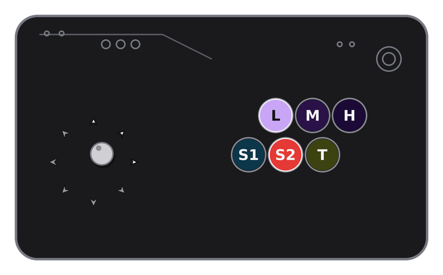
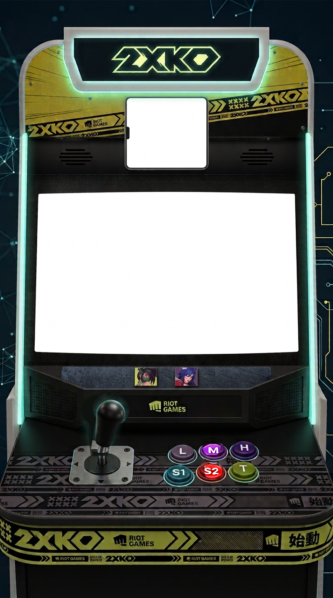

# 2XKO Input Display -- Dual Edition

One script, one command, two windows: the original procedurally-drawn
**Classic** arcade stick and the photo-based **Cabinet** overlay, both
driven by a single shared read of your controller (it's polled once per
frame and fed to both windows -- not read twice).




## 1. Install

```
pip install pygame pillow
```

- **pygame** reads the joystick.
- **pillow** loads/composites the PNG art assets.
- **Tk** is also required (ships with python.org's Windows installer;
  on Linux: `sudo pacman -S tk` on Arch/Steam Deck, `sudo apt install
  python3-tk` on Debian/Ubuntu).

Keep `input_display.py`, `classic_procedural/`, and `cabinet_photo/`
together in the same directory. **No pre-built art is shipped** — only
the code and `cabinet_source.jpg` (Cabinet's source photo). The first
time you run `input_display.py`, whichever window(s) you're showing get
their assets built automatically, right there in that subfolder's
`assets/` folder (a few seconds, one-time; it only runs again if that
folder is later missing or empty). You'll see this in the console:

```
Classic: no generated assets found -- building them now (one-time, a few seconds)...
Classic: generated 38 assets in .../classic_procedural/assets
Cabinet: no generated assets found -- building them now from cabinet_source.jpg (one-time, a few seconds)...
Cabinet: generated 16 assets in .../cabinet_photo/assets
```

Want to change a version's design (colors, positions, tilt angle, etc.)?
Edit the constants near the top of that subfolder's `generate_assets.py`,
delete its `assets/` folder, and the next run rebuilds it. Running that
file directly (`python generate_assets.py` from inside a subfolder)
still works too, same as always.

## 2. Run it

```
python input_display.py
```

Both windows open — **"2XKO Input Display - Classic"** and **"2XKO Input
Display - Cabinet"** — positioned side by side by default. Only want one?

```
python input_display.py --only classic
python input_display.py --only cabinet
```

Works immediately with the **keyboard**, even with no stick plugged in —
click into either window so it has focus:

| Input      | Key(s)     |
|------------|------------|
| Directions | Arrow keys |
| L / M / H  | U / I / O  |
| S1 / S2 / T| J / K / L  |

## 3. Map a real stick/pad's buttons

One controller, one mapping, shared by both windows:

```
python input_display.py --calibrate
```

Press each button when prompted (wait out the ~12s timeout to skip one).
Writes **button_map.txt** next to this script, read automatically by
every mode (`--only classic`, `--only cabinet`, `--send`) on future runs.
Shoulder/trigger buttons that report as an analog axis (common on
Xbox-style pads) are detected automatically — see the generated file's
own comments for the `axis:N` syntax if you ever want to hand-tune one.

## 4. Add them to OBS

Same rules as either version had standalone — each window is its own
Window Capture source, picked out by its distinct title.

**Windows:**
1. **Sources → + → Window Capture**, pick **"2XKO Input Display -
   Classic"** (repeat for **"... - Cabinet"** as a second source).
2. Tick **Client Area** on each to crop out the title bar.
3. No key filter needed — the transparency is real.

**Linux / Steam Deck (Desktop Mode):**
1. **Sources → + → Window Capture (Xcomposite)** on X11, or **Screen
   Capture (PipeWire)** on Wayland — one source per window, same as above.
2. Add a **Color Key** filter (not *Chroma Key*) to each, key color
   `#010203`, adjust similarity/smoothness until the background's gone.

The Cabinet window is portrait (768×1376) — a natural fit for a vertical
canvas as-is. The Classic window is landscape (900×560) — better suited
to a horizontal band if you're also going vertical.

### Keeping them off your desktop without minimizing (Windows only)

```
python input_display.py --offscreen
```

Parks both windows past your monitors' edges (`OFFSCREEN_POSITION_CLASSIC`
/ `_CABINET` near the top of the script) instead of minimizing — which
stops Windows from rendering them at all, so no capture method could see
them either. Make sure each Window Capture source uses the **"Windows 10
(1903+)"** method. Skipped on Linux (use OBS's own crop/position tools
there) for the same reasons as either version had standalone.

## 5. Controller on one machine, OBS on another

Same idea as the Cabinet version had on its own, now covering whichever
window(s) you ask for:

```
python input_display.py --send <the-other-machine's-LAN-IP>
```
Reads the controller, transmits over UDP (port `5721` by default,
`NETWORK_PORT` near the top of the script). No window opens here.

```
python input_display.py --listen
python input_display.py --listen --only cabinet
```
Opens the window(s) driven by whatever arrives over the network instead
of a local controller. Because rendering happens on the machine actually
being captured, the normal OBS/transparency rules from section 4 apply
unchanged. Falls back to neutral/all-off if the sender goes quiet for
1.5s, rather than freezing on the last pose. Keyboard fallback still
works locally too, layered on top of the network state.

## How it's structured

```
input_display.py            <- the one entry point, run this
classic_procedural/
  generate_assets.py        <- re-run to change Classic's design
  assets/                   <- NOT shipped; built on first run
cabinet_photo/
  generate_assets.py        <- re-run to change Cabinet's design
  cabinet_source.jpg        <- the source photo (this IS shipped)
  assets/                   <- NOT shipped; built on first run
```

`input_display.py` loads both `generate_assets.py` files by explicit
path (they're both literally named the same thing, in different
folders, so a normal `import` would only ever find one) purely to read
their layout constants and know where each `assets/` folder is — it
doesn't re-run either generator itself. One `ClassicScene` and one
`CabinetScene` class each own their window's canvas and image set; the
app's single poll loop computes the controller state once per frame and
calls `.update(lever_state, button_states)` on whichever scene(s) exist.

## Known limitations

- Real per-pixel window transparency is **Windows-only**; both windows
  fall back to solid `#010203` + OBS Color Key on Linux/Steam Deck.
- `--offscreen` is also **Windows-only**.
- Only reads the first connected joystick (`Joystick(0)`), shared by
  both windows.
- Closing the Cabinet window on its own (when both are open) just hides
  it — closing the Classic/main window closes the whole app, same as any
  normal program's main window.
- **Steam Deck:** run from **Desktop Mode** — Game Mode's Gamescope
  compositor isn't a target for OBS's capture sources.
